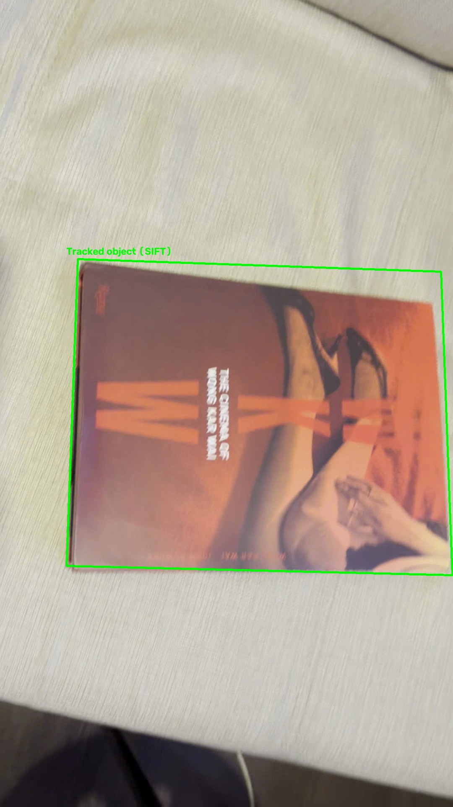
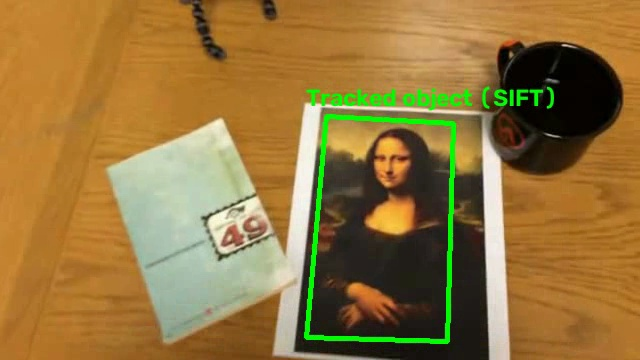
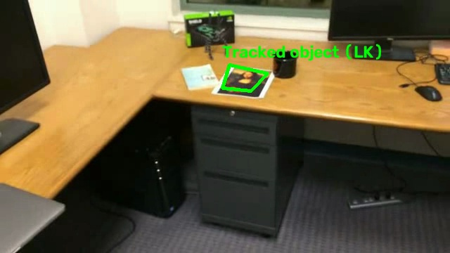
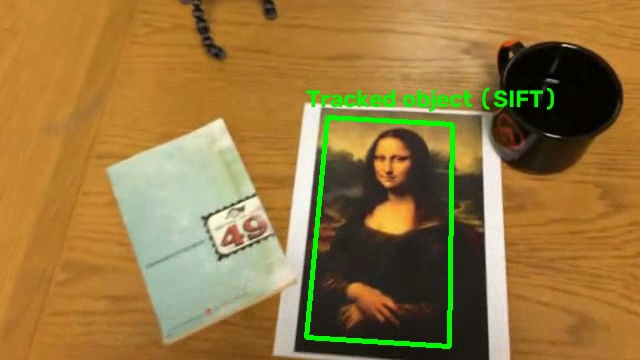
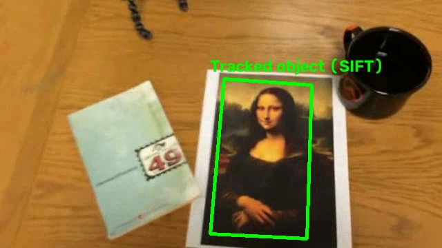

# Лабораторная работа №2. Трекинг плоского объекта на видео

**Дисциплина:** Компьютерное зрение  
**Задача:** отслеживание прямоугольного плоского объекта на видеопоследовательности по ключевым точкам.

Программа использует первый кадр видео для задания эталонной области (ROI). На следующих кадрах она пытается определить положение объекта, построить четырёхугольную рамку и подписать объект.

## 1. Теоретическая база

**Ключевые точки и дескрипторы.** Для поиска объекта применяется SIFT (Scale-Invariant Feature Transform). Алгоритм выделяет характерные точки изображения и вычисляет для них дескрипторы, которые можно сопоставлять между эталоном и текущим кадром. SIFT устойчив к изменению масштаба и повороту в определённых пределах.

**Сопоставление признаков.** Дескрипторы сравниваются с помощью BFMatcher и евклидова расстояния (L2). Для каждой точки ищутся два ближайших соседа, затем применяется тест Лоу (ratio test), уменьшающий число неоднозначных соответствий.

**Гомография и RANSAC.** Для плоского объекта перспективное преобразование между эталоном и кадром приближённо описывается матрицей гомографии $H$ размерности $3\times3$. Алгоритм RANSAC оценивает $H$ по согласованным соответствиям, отбрасывая выбросы. Точки, согласующиеся с найденной моделью, называются *inliers*. Углы эталона преобразуются через $H$, формируя рамку объекта.

**Оптический поток Лукаса–Канаде.** Если на текущем кадре SIFT не смог построить допустимую рамку, используется разреженный оптический поток. Он оценивает перемещение ранее отслеженных точек между соседними кадрами. По сохранившимся соответствиям между эталоном и текущим кадром повторно вычисляется гомография.

## 2. Описание разработанной системы

### Архитектура

- `main.py`: чтение видео, выбор и кэширование ROI, запуск трекера, рисование рамки, сохранение результатов и метрик.
- `tracker.py`: поиск и сопоставление SIFT-признаков, оценка гомографии, резервный трекинг Lucas–Kanade и проверка геометрии.
- `generate_report.py`: формирование настоящего отчёта по CSV и обработанным видео.
- `videos/`: входные видео, включая самостоятельно снятый ролик.
- `results/roi/`: сохранённые координаты эталонных областей.
- `results/debug/`: изображения соответствий для анализа проблемных кадров.
- `results/`: размеченные видео и таблица `tracking_metrics.csv`.

### Алгоритм обработки

1. Из первого кадра выделяется эталонная область; её координаты сохраняются в JSON для воспроизводимости эксперимента.
2. На эталоне один раз вычисляются ключевые точки и дескрипторы SIFT.
3. На очередном кадре находятся SIFT-соответствия и оценивается гомография методом RANSAC.
4. При успешной оценке проверяется геометрия четырёхугольника; согласованные точки сохраняются для следующего кадра.
5. Если SIFT не дал допустимой рамки, выполняется Lucas–Kanade по точкам предыдущего кадра, затем повторная оценка гомографии и проверка рамки.
6. Если оба метода не сработали, рамка не рисуется; на следующем кадре выполняется новая попытка обнаружения.
7. Для успешных кадров рисуются четырёхугольник и подпись, а результаты сохраняются в MP4 и CSV.

### Запуск

Требуются Python, `opencv-python` и `numpy`. Запуск из корня проекта:

```bash
python -m pip install opencv-python numpy
python main.py
python generate_report.py
```

Для повторного выбора эталонной области: `python main.py --reselect-roi`.

## 3. Результаты работы и тестирования системы

Обработано **5 видео**, всего **2723 кадров** (первый кадр каждого видео используется как эталон и не входит в подсчёт). Рамка построена на **1945 кадрах (71.4%)**.

Доля обнаружений определяется как число кадров с построенной рамкой, делённое на число обрабатываемых кадров. Эта метрика не равна точности геометрической локализации, поскольку разметка истинных границ объекта отсутствует.

| Видео | Кадров | SIFT | Lucas–Kanade | Обнаружено | Доля обнаружений |
|---|---:|---:|---:|---:|---:|
| `IMG_6514.MOV` | 496 | 466 | 18 | 484 | 97.6% |
| `mona-lisa-blur-extra-credit.avi` | 557 | 279 | 39 | 318 | 57.1% |
| `mona-lisa-blur.avi` | 557 | 283 | 254 | 537 | 96.4% |
| `mona-lisa.avi` | 557 | 311 | 57 | 368 | 66.1% |
| `simple_track.avi` | 556 | 163 | 75 | 238 | 42.8% |
| **Итого** | **2723** | **1502** | **443** | **1945** | **71.4%** |

Резервный трекинг Lucas–Kanade обеспечил **443 дополнительных обнаружений** (22.8% от всех обнаружений). В данной реализации метод LK запускается только после неуспешного SIFT.

### Анализ причин пропусков

| Причина | Число кадров |
|---|---:|
| Не найдены дескрипторы | 1 |
| Недостаточно соответствий | 18 |
| Не удалось оценить гомографию | 51 |
| Недостаточно inliers | 601 |
| Некорректная геометрия рамки | 107 |

### Примеры результатов

**IMG_6514.MOV**



**mona-lisa-blur-extra-credit.avi**



**mona-lisa-blur.avi**



**mona-lisa.avi**



**simple_track.avi**



## 4. Выводы по работе

Реализован алгоритм трекинга плоского объекта на основе ключевых точек SIFT, оценки гомографии методом RANSAC и резервного оптического потока Lucas–Kanade. Система автоматически обрабатывает набор видео и сохраняет рамки, диагностические изображения и количественные показатели.

На 5 видео получена общая доля обнаружений **71.4%**. Качество зависит от текстуры объекта, масштаба, смазывания, числа корректных соответствий и допустимости найденной геометрии.

На самостоятельно снятом видео `IMG_6514.MOV` рамка построена на **484 из 496 кадров (97.6%)**.

Добавление Lucas–Kanade позволило продолжать отслеживание на кадрах, где SIFT не прошёл проверки. Однако наличие рамки само по себе не гарантирует точности её положения; для количественной оценки ошибки локализации потребовалась бы покадровая разметка эталонных границ.

## 5. Использованные источники

1. Lowe D. G. (2004). Distinctive Image Features from Scale-Invariant Keypoints. *International Journal of Computer Vision*, 60, 91–110. https://doi.org/10.1023/B:VISI.0000029664.99615.94
2. Fischler M. A., Bolles R. C. (1981). Random Sample Consensus: A Paradigm for Model Fitting with Applications to Image Analysis and Automated Cartography. *Communications of the ACM*, 24(6), 381–395. https://doi.org/10.1145/358669.358692
3. Lucas B. D., Kanade T. (1981). An Iterative Image Registration Technique with an Application to Stereo Vision. *IJCAI 1981*, 674–679.
4. OpenCV documentation: Feature Matching, Homography, Optical Flow. https://docs.opencv.org/4.x/
5. Методические указания к лабораторной работе №2 по компьютерному зрению (`LW2_25.pdf`).
